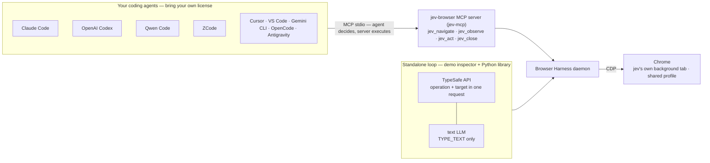

# Jev Ultrafast ⚡

**A browser agent with a dynamic, indexed action space.**

Give it one natural-language goal. [TypeSafe's Jev](https://docs.typesafe.ai/introduction) picks the next operation and the target element in a single request. A small LLM writes text only when the operation is `TYPE_TEXT`. Model output never becomes selectors, coordinates, shell commands, or executable JavaScript.

> [!IMPORTANT]
> **Ships with a ready-made MCP server — `jev-browser`.** Register it once with `make install` and your existing coding agents — **Claude Code, Codex, Qwen Code, ZCode**, Cursor, VS Code, Gemini CLI, OpenCode, Google Antigravity — drive a real, indexed browser through `jev_navigate` / `jev_observe` / `jev_act` / `jev_close` on their own license. No extra API keys: your agent is the brain, the MCP server only observes and executes. See [MCP server](#mcp-server-jev-browser).

<a href="docs/demo.mp4"></a>

[Watch the MP4](docs/demo.mp4) · [Measurements](docs/performance.md) · [Read the loop](jev_ultrafast/agent/agent.py)

## How it works

Every observation produces a fresh element table with stable indexes:

```text
[1] button    Change ticket type · Round trip
[2] combobox  Where from?        · San Francisco
[3] combobox  Where to?          · empty
[4] textbox   Departure          · empty
```

Operations: `CLICK`, `TYPE_TEXT`, `SELECT`, `SCROLL_UP`, `SCROLL_DOWN`, `WAIT`, `DONE`, `BLOCKED`. One TypeSafe request returns an operation plus operation-specific target heads; only the selected operation's target executes — two decisions, one network round trip.

```text
page → element table → TypeSafe (operation + targets) → matching target → browser
                                                       └→ TYPE_TEXT → small LLM → text → browser
```

There are no site-specific action scripts or prepared field values. Every executed target is resolved from an observed DOM node, rechecked for freshness and click occlusion, and the outcome is verified independently — a `DONE` choice alone is not proof of success.

## Installation

### Prerequisites

- **[uv](https://docs.astral.sh/uv/)** — `curl -LsSf https://astral.sh/uv/install.sh | sh`
- **Node.js** — for JS syntax checks
- **Google Chrome** — see [Chrome remote debugging](#chrome-remote-debugging) below
- **Browser Harness** — see [Browser Harness](#browser-harness) below
- **API keys** — see [TypeSafe API](#typesafe-api) below

### Steps

```bash
git clone https://github.com/browser-use/jev-ultrafast.git
cd jev-ultrafast
make build
```

`make build` prepares everything: dependencies (including Browser Harness), a `.env` scaffold, JS syntax checks, lint, tests, and the package build.

Add your keys to `.env`, make sure Chrome is running, then start the inspector:

```bash
uv run jev
# open http://127.0.0.1:8766 → Start demo → Run automatically
```

The inspector shows numbered elements, operation/target probabilities, and executed actions. **Choose next** pauses before execution.

### Browser Harness

[Browser Harness](https://github.com/browser-use/browser-harness) is the local daemon that bridges Python and Chrome over the Chrome DevTools Protocol (CDP). It ships as a pinned dependency (`browser-harness`) and is installed automatically by `uv sync` / `make build` — no separate install step.

- The daemon **auto-starts** the first time a browser session is created (demo, library, or MCP server). It attaches to your running Chrome and opens its **own background tab** — your active tab is never taken over, and owned tabs share your existing Chrome profile.
- Check health at any time:

```bash
uv run browser-harness --version   # installed version
uv run browser-harness --doctor    # diagnose install, daemon, and browser state
```

- **Linux with Snap-packaged Chromium**: Snap sandboxing blocks CDP. Run `uv run browser-harness doctor --fix-snap` for the fix, or use a non-Snap Chrome/Chromium.
- `make doctor` runs this check as part of the full stack report.

### Chrome remote debugging

The agent drives Chrome through its remote-debugging (CDP) channel, which Browser Harness enables on first connect. You start Chrome normally — no manual `--remote-debugging-port` flag, no restart.

- **macOS**: the first time the daemon connects, Chrome shows a native **"Allow remote debugging"** permission sheet. Click **Allow**, or pre-approve it from the terminal:

```bash
uv run browser-harness mac-approve
```

- **Linux/Windows**: no extra permission step; if the connection fails, run `uv run browser-harness --doctor` and follow its output.
- Chrome should be open before you start the demo. `make doctor` warns if it is not running yet.

### TypeSafe API

TypeSafe is the decision engine of the agent loop: each step sends it the element table, and it returns the operation plus target in a single request. Without a key, the demo and library loops cannot choose actions.

- Get a key from [TypeSafe](https://docs.typesafe.ai), put it in `.env` as `TYPESAFE_API_KEY`. Requests go to `https://api.typesafe.ai/v1`; the model defaults to `jev-latest` (override with `TYPESAFE_MODEL`).
- **Who needs it**: the demo inspector and the Python library loop. **The MCP server does not** — there your coding agent (Claude Code, Codex, Qwen Code, ZCode, …) is the brain and the server only observes and executes.
- `TYPE_TEXT` additionally needs `TEXT_MODEL_API_KEY` (any OpenAI-compatible provider — see [Configuration](#configuration)). Without it, everything works except typing text.
- Only the demo, live examples, and recording scripts make paid TypeSafe calls; tests are offline and never do.

### Steps

```bash
git clone https://github.com/browser-use/jev-ultrafast.git
cd jev-ultrafast
make build
```

`make build` prepares everything: dependencies, a `.env` scaffold, JS syntax checks, lint, tests, and the package build.

Add your keys to `.env`, then start the inspector:

```bash
uv run jev
# open http://127.0.0.1:8766 → Start demo → Run automatically
```

The inspector shows numbered elements, operation/target probabilities, and executed actions. **Choose next** pauses before execution. When Chrome prompts for remote debugging, allow it; if the connection needs fixing, run `uv run browser-harness --doctor`.

## Configuration

### Environment variables (`.env`, git-ignored)

| Variable | Required | Default | Purpose |
| --- | --- | --- | --- |
| `TYPESAFE_API_KEY` | yes | — | TypeSafe Jev: operation + target selection |
| `TYPESAFE_MODEL` | no | `jev-latest` | TypeSafe model id |
| `TEXT_MODEL_API_KEY` | for `TYPE_TEXT` | — | Text helper used only by `TYPE_TEXT` |
| `TEXT_MODEL_BASE_URL` | no | `https://openrouter.ai/api/v1` | OpenAI-compatible endpoint |
| `TEXT_MODEL` | no | `inception/mercury-2.5` | Text model id |
| `TEXT_MODEL_REASONING` | no | `none` | Set to `none` to disable reasoning in the text helper |
| `TYPESAFE_DEMO_PORT` | no | `8766` | Inspector port |

### URLs

| URL | What it is |
| --- | --- |
| `http://127.0.0.1:8766` | Local demo inspector (`uv run jev`) |
| `https://api.typesafe.ai/v1` | TypeSafe API used by the agent loop |
| `https://openrouter.ai/api/v1` | Default text-model endpoint (`.env.example`) |

The text helper works with any OpenAI-compatible provider — DeepSeek (`https://api.deepseek.com/v1`, `deepseek-chat` is the code-level fallback), OpenAI, Gemini, GLM, or local Ollama. Set `TEXT_MODEL_BASE_URL`, `TEXT_MODEL`, and `TEXT_MODEL_API_KEY` accordingly. For a programmatic custom provider, see [docs/text-provider-guide.md](docs/text-provider-guide.md) and [examples/custom_text_provider.py](examples/custom_text_provider.py).

## MCP server (`jev-browser`)

The browser layer ships as a standalone MCP stdio server (`jev-mcp`) so coding agents — Claude Code, Codex, Qwen Code, ZCode, Cursor, VS Code, and any other MCP client — can drive a real browser with their existing licenses. The server only observes and executes; **your coding agent is the brain** and makes every decision from the indexed element table. The server itself calls no model, so no API keys are required to use it.



The same Browser Harness + Chrome layer serves both paths: through the MCP server your coding agent decides each step from the element table; through the standalone loop TypeSafe decides.

### Desktop MCP server (`jev-desktop`, opt-in)

The same indexed-element loop works for **desktop apps on macOS** through the Accessibility (AX) API. The observation source changes; the contract does not: numbered elements, one operation + target per step, guard-checked execution, zero model calls and zero API keys.

```bash
make install-all [agent]  # register jev-browser AND jev-desktop (explicit opt-in)
```

| Tool | Arguments | Does |
| --- | --- | --- |
| `desktop_attach` | `app` | Attach to one app by bundle id — allowlisted via `JEV_DESKTOP_ALLOW` (default: `com.google.Chrome` only) |
| `desktop_observe` | — | App title, text preview, and numbered interactive elements |
| `desktop_act` | `action_id`, `text?` | Click (`AXPress`), type (`AXValue` write + read-back), or wait — stale decisions are refused |
| `desktop_close` | — | Detach |

Scope and safety: macOS only (pyobjc, marker-gated dependency). v1 covers app chrome UI — menu bar, tabs, fields, window controls — verified against Chrome ([spike](docs/plans/desktop-app-layer/spike-activation.md)); web content stays with the CDP browser layer. An AX-trusted process can drive *any* app, so the allowlist is deliberately tight and `jev-desktop` is never registered by `make install` alone. Live verification: `make check-desktop` (skips when Chrome/Accessibility is unavailable). See [jev_ultrafast/desktop/README.md](jev_ultrafast/desktop/README.md).

### Tools

| Tool | Arguments | Does |
| --- | --- | --- |
| `jev_navigate` | `url` | Open a URL; creates the browser session if needed |
| `jev_observe` | `screenshot?` | Return URL, title, text preview, and numbered interactive elements |
| `jev_act` | `action_id`, `text?` | Click, type (`text` required for fill actions), or select an element by id |
| `jev_close` | — | Close the browser session |
| `jev_config` | API key/url/model fields | Update TypeSafe/text-model config at runtime |

### One-command install

```bash
make install              # register with every detected agent
make install cursor       # one agent only (claude, codex, qwen, zcode, ...)
make install-dry          # show what would be written, change nothing
make doctor               # deps, API keys, Chrome, browser-harness, MCP registrations
uv run python scripts/install_mcp.py --status   # current registration status
```

Registration is idempotent: re-running replaces only the `jev-browser` entry and leaves every other configured server untouched.

### Supported agents

| Key | Agent | Config file written |
| --- | --- | --- |
| `claude` | Claude Code | `~/.claude.json` (`claude mcp add`, user scope) |
| `codex` | OpenAI Codex CLI | `~/.codex/config.toml` (`[mcp_servers."jev-browser"]`) |
| `commandcode` | Command Code | `~/.commandcode/mcp.json` |
| `vscode` | VS Code | `…/Code/User/mcp.json` (`servers`) |
| `cursor` | Cursor | `~/.cursor/mcp.json` |
| `qwen` | Qwen Code | `~/.qwen/settings.json` |
| `ayg` | Google Antigravity | `~/.gemini/config/mcp_config.json` |
| `gemini` | Gemini CLI | `~/.gemini/settings.json` |
| `opencode` | OpenCode | `~/.config/opencode/opencode.json` |
| `zcode` | ZCode | `~/.zcode/cli/config.json` |

Credentials are **never written into agent configs**. Every entry spawns `uv --directory <project> run --env-file <project>/.env jev-mcp`, so the server loads keys from the git-ignored `.env` at startup.

### Manual registration (any MCP client)

```json
{
  "mcpServers": {
    "jev-browser": {
      "type": "stdio",
      "command": "/absolute/path/to/uv",
      "args": [
        "--directory",
        "/absolute/path/to/jev-ultrafast",
        "run",
        "--env-file",
        "/absolute/path/to/jev-ultrafast/.env",
        "jev-mcp"
      ]
    }
  }
}
```

Replace `/absolute/path/to/uv` with your real `uv` binary (`which uv`, typically `~/.local/bin/uv`) and `/absolute/path/to/jev-ultrafast` with the project directory. The absolute `command` matters: some agents spawn MCP servers without your shell's `PATH`, where a bare `uv` fails to resolve. `--env-file` loads the git-ignored `.env` so keys never appear in the agent config; drop that flag if you keep no `.env`.

Or run it by hand to verify: `uv run jev-mcp` from the project directory.

### How agents use it

Once registered, just give your agent a goal in its normal chat — Claude Code, Codex, Qwen Code, and ZCode all drive the same three-tool loop:

```text
You: Open google.com and search for "browser-use jev-ultrafast"

Agent: 1. jev_navigate("https://www.google.com")
       2. jev_observe()                 → [1] textbox Search  [2] button Google Search …
       3. jev_act("e1", "browser-use jev-ultrafast")
       4. jev_act("e2")                 → results page
       5. jev_close()
```

Rules the host agent should follow:

- Call `jev_observe` after every navigation or action — element ids change with each snapshot, so never reuse an id from an older observation.
- Pass `text` for fill/type actions; click and select take only `action_id`.
- If `jev_act` reports an error, observe again and re-decide instead of retrying the same id.

## Use as a library

The full TypeSafe loop:

```python
from jev_ultrafast import Agent

with Agent(
    "https://www.google.com/travel/flights?hl=en",
    "Find one-way flights from Zurich to London on September 20, 2026, "
    "for one adult in economy. Stop when matching flight options are visible.",
) as agent:
    for state in agent.run():
        print(state["elapsed_ms"], state["status"])
```

Run with `uv run --env-file .env python your_script.py`. A generic task:

```bash
uv run --env-file .env python examples/run.py \
  --url https://en.wikipedia.org/wiki/Main_Page \
  --goal 'Find and open the Wikipedia article about Gödel’s incompleteness theorems.'
```

Or swap the TypeSafe agent for your own — the browser layer is standalone:

```python
from jev_ultrafast.browser import Browser

browser = Browser("https://example.com")
page = browser.observe()          # numbered element table

action = next(a for a in page["actions"] if a["id"] == "e2")
browser.act(action, page, text="hello")
```

See [examples/external_agent.py](examples/external_agent.py) and [docs/architecture.md](docs/architecture.md). [examples/flights.py](examples/flights.py) runs the verified flight search (`--keep-open` keeps the browser open).

## Project layout

| File | Job |
| --- | --- |
| [jev_ultrafast/browser/browser.py](jev_ultrafast/browser/browser.py) | CDP connection, DOM observation, action execution |
| [jev_ultrafast/browser/snapshot.js](jev_ultrafast/browser/snapshot.js) | Atomic DOM snapshot, indexed controls, freshness guards |
| [jev_ultrafast/desktop/](jev_ultrafast/desktop/) | macOS AX layer: `ax.py` bridge, `tree.py` walker, `app.py` facade |
| [jev_ultrafast/agent/agent.py](jev_ultrafast/agent/agent.py) | The complete loop and text-helper handoff |
| [jev_ultrafast/agent/model.py](jev_ultrafast/agent/model.py) | TypeSafe operation/target heads and text generation |
| [jev_ultrafast/mcp_server.py](jev_ultrafast/mcp_server.py) | `jev-browser` MCP server |
| [jev_ultrafast/desktop_mcp.py](jev_ultrafast/desktop_mcp.py) | `jev-desktop` MCP server (opt-in) |
| [jev_ultrafast/demo.py](jev_ultrafast/demo.py) | Local inspector (`jev`) |
| [scripts/install_mcp.py](scripts/install_mcp.py) | MCP registration for coding agents (both servers) |
| [scripts/check_ax.py](scripts/check_ax.py) | Live desktop AX check against real Chrome |
| [scripts/doctor.py](scripts/doctor.py) | Stack health check |

## Development

```bash
uv run ruff check .
uv run pytest
node --check jev_ultrafast/static/app.js
node --check jev_ultrafast/browser/snapshot.js
uv build
```

Tests are offline. `uv run python scripts/check_guards.py` checks real controls in a local browser without model calls. Live examples and the recording scripts (`scripts/record_flights.py`, `scripts/render_demo.py`) make paid API calls; credentials and raw traces stay ignored. Run boundaries and raw evidence live in [docs/performance.md](docs/performance.md).

## Scope and limits

The DOM reader handles common HTML and ARIA controls, not the full accessible-name specification. Shadow roots, frames, canvas, uploads, pop-up tabs, nested scrolling, and arbitrary keyboard widgets remain outside this MVP. Owned tabs share the existing Chrome profile.

---

[Browser Use](https://github.com/browser-use/browser-use) · [Browser Harness](https://github.com/browser-use/browser-harness) · [TypeSafe speculative fan-out](https://docs.typesafe.ai/patterns/fan-out)
